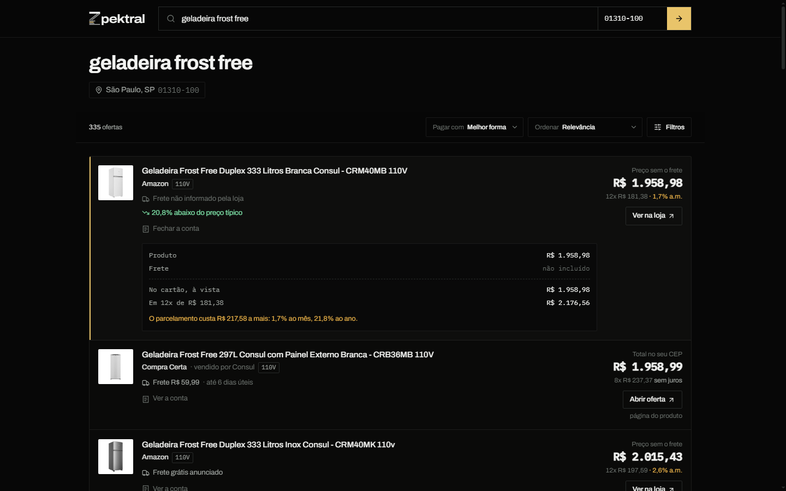
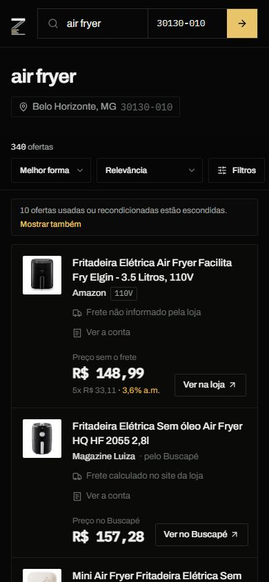
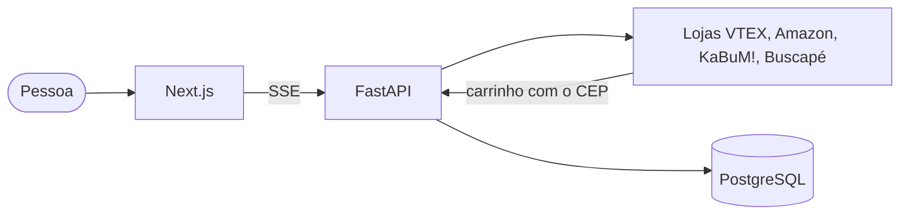

<p align="center">
  
</p>

<h1 align="center">zpektral</h1>

<p align="center">
  Compara o preço final de um produto em dezenas de lojas brasileiras, já com o frete para o seu CEP.
</p>

<p align="center">
  <a href="https://zpektral.vercel.app">Abrir o site</a> ·
  <a href="https://zpektral-api.vercel.app/docs">Documentação da API</a>
</p>

<p align="center">
  <a href="https://github.com/noitsuka/zpektral/actions/workflows/ci.yml"></a>
</p>


## Visão geral

O preço de um anúncio raramente é o que se paga. O frete muda conforme o CEP, o Pix costuma ter desconto, o parcelamento pode ter juros e algumas lojas somam impostos que só aparecem no fim da compra.

O zpektral faz esse caminho em cada loja ao mesmo tempo. A pessoa digita o produto e o CEP, o site coloca o item no carrinho de cada loja, lê o valor que seria cobrado na hora de pagar e mostra as lojas lado a lado, da mais barata para a mais cara. Os resultados aparecem enquanto as lojas respondem, e a busca inteira leva poucos segundos.

**Para testar:** abra o [site](https://zpektral.vercel.app), digite "geladeira frost free" ou "air fryer" e um CEP qualquer.

## Telas

| Resultado de uma busca | No celular |
| --- | --- |
|  |  |

## Funcionalidades

**Para quem compra**

- Preço final de cada loja para o CEP informado, com frete, prazo e transportadora
- Conta aberta de cada oferta: desconto no Pix, frete e o custo dos juros do parcelamento em reais
- Aviso quando a oferta está abaixo ou acima do preço típico do produto entre as lojas
- Histórico do preço na própria loja, com o aviso "menor preço desta loja em N dias" quando for o caso
- Busca que entende nomes diferentes para o mesmo produto, como "máquina de lavar louça" e "lava-louças", e corrige erros de digitação e acentos esquecidos, como "geladiera" e "fogao"
- Separação entre o produto e as peças dele: o cesto da air fryer não aparece como air fryer
- Filtros por voltagem, condição e forma de pagamento
- Buscas recentes guardadas só no navegador

**Por baixo**

- O valor exibido vem do carrinho da loja, sem estimativa; o que a loja não informa aparece como não informado
- Parte das cotações é refeita em paralelo, e o vendedor que devolve valores diferentes para o mesmo carrinho perde o selo de preço exato
- Nenhum bloqueio das lojas contra robôs é contornado
- O histórico guarda só os cinco primeiros dígitos do CEP e apaga registros com mais de 180 dias

## Lojas

64 lojas da plataforma VTEX (Carrefour, Americanas, Atacadão, Casa&Video, WebContinental, Drogaria São Paulo, Época Cosméticos, Asics, Obramax e outras de eletro, casa, construção, moda, esporte, beleza, farmácia e mercado), mais Amazon, KaBuM! e Buscapé. Mercado Livre, Shopee e eBay estão integrados pelas APIs oficiais e entram quando as credenciais são configuradas.

O frete é cotado no carrinho das lojas VTEX e dos vendedores dentro delas. Amazon, KaBuM! e Buscapé entram com o preço e o frete que mostram publicamente. Produtos do eBay vindos do exterior aparecem com o imposto de importação estimado e uma marca própria.

## Stack

| Camada | Tecnologias |
| --- | --- |
| Backend | Python 3.14, FastAPI, httpx, SQLAlchemy 2 (async), Pydantic 2, Alembic |
| Banco | PostgreSQL 17 em produção, SQLite no desenvolvimento |
| Frontend | Next.js 16, React 19, TypeScript, Tailwind CSS 4 |
| Qualidade | pytest, Hypothesis, Vitest, Ruff, Pyright, ESLint, Prettier, Knip, GitHub Actions |
| Infra | Docker, Vercel, Neon |

## Arquitetura



Cada busca vira um trabalho único por produto e CEP: quem pede a mesma coisa ao mesmo tempo espera o mesmo trabalho, e o resultado fica em cache por cinco minutos. As lojas respondem em paralelo e cada uma entra na tela assim que termina.

```
backend/app/
  fontes/         um adaptador por loja, todos com a mesma interface
  busca.py        execução em paralelo, cache e limpeza dos dados das lojas
  relevancia.py   nota de cada título contra a busca, sinônimos, erros de digitação, peças
  agrupamento.py  mesmo produto em lojas diferentes, por EAN e código de modelo
  historico.py    histórico de preços por oferta
  limites.py      limites por endereço e cabeçalhos de segurança
frontend/src/
  app/            página inicial, resultados e privacidade
  componentes/    globo das rotas, linha da oferta com a conta, filtros
  nucleo/         filtros, juros, preço típico e tendência (funções puras)
docs/decisoes/    registro das decisões
```

## Decisões técnicas

1. [O carrinho da loja é a fonte da verdade](docs/decisoes/01-checkout-como-fonte-da-verdade.md). Só o valor lido no carrinho recebe o selo de preço exato.
2. [Só fontes abertas ou oficiais](docs/decisoes/02-fontes-abertas-ou-oficiais.md). Páginas públicas permitidas pelo `robots.txt` ou APIs oficiais.
3. [Mesmo produto em lojas diferentes](docs/decisoes/03-identidade-do-produto.md). Agrupado por EAN e código de modelo, nunca só pelo título.
4. [Um processo, com estado em memória](docs/decisoes/04-um-processo-com-estado-em-memoria.md). Cache e limites sem Redis, até o volume pedir.
5. [Conferência das cotações](docs/decisoes/05-auditoria-de-cotacoes.md). Cotações repetidas em paralelo para achar preços instáveis.
6. [Importados com total estimado](docs/decisoes/06-importados-com-total-estimado.md). Imposto de importação e ICMS calculados à parte e marcados.
7. [Símbolo em forma de prisma](docs/decisoes/07-simbolo-prisma.md). O Z separa o preço anunciado nas linhas de cada loja.
8. [Histórico de preço na própria loja](docs/decisoes/08-historico-por-oferta.md). O preço de hoje comparado com o habitual daquela loja.

## Segurança

| Cenário | Resposta |
| --- | --- |
| Muitas buscas novas do mesmo endereço | `429`, com limite bem menor que o de leituras do cache |
| `X-Forwarded-For` forjado ou troca de IPv6 dentro do mesmo /64 | o limite continua valendo |
| Loja que redireciona para um endereço interno | requisição recusada, só hosts públicos e `https` |
| Resposta gigante de uma loja | cortada no teto de tamanho |
| HTML ou caracteres de controle num título | removidos antes de chegar ao site |
| Erro inesperado | `500` com mensagem genérica e código de correlação |

Credenciais ficam só em variáveis de ambiente e nunca aparecem nos logs. O site envia uma Content-Security-Policy que só aceita código da própria origem e conexões com a API.

## Testes

```bash
cd backend
pip install -e ".[dev]"
pytest
```

Mais de 800 testes, com respostas reais das lojas gravadas, testes de propriedades e 300 entradas aleatórias contra a API. A suíte `pytest -m live` busca cinco produtos em cinco capitais, sorteia ofertas e refaz o carrinho na loja para conferir o total; na última execução, 300 ofertas conferidas e nenhuma divergência. No frontend, `npm test`, `npm run lint` e `npx knip`, e a CI confere tipos e o build.

## Executando localmente

Requisitos: Docker, ou Python 3.12+ e Node.js 24.

```bash
docker compose up --build
```

Site em `http://localhost:3000` e API em `http://localhost:8000` (documentação em `/docs`). Sem Docker, a API sobe com `uvicorn app.main:app` dentro de `backend` e o site com `npm run dev` dentro de `frontend`. Sem banco configurado, o histórico vai para um arquivo SQLite local.

## Deploy

Site e API são dois projetos na Vercel, e o banco é um PostgreSQL no Neon conectado pela integração da Vercel. A API roda na região de São Paulo ([`backend/vercel.json`](backend/vercel.json)): saindo dos Estados Unidos, a mesma busca perdia 13 lojas.

| Variável | Onde | Descrição |
| --- | --- | --- |
| `DATABASE_URL_UNPOOLED` | API | conexão direta ao PostgreSQL (preenchida pela integração) |
| `ORIGENS_CORS` | API | lista JSON com a origem do site |
| `CONFIAR_PROXY` | API | `true` atrás do proxy da Vercel |
| `HSTS` | API | `true` em produção |
| `ML_ID_CLIENTE`, `SHOPEE_ID_APP`, `EBAY_ID_CLIENTE` e segredos | API | opcionais, ativam Mercado Livre, Shopee e eBay |
| `NEXT_PUBLIC_URL_API` | Site | URL pública da API |
| `NEXT_PUBLIC_URL_SITE` | Site | URL pública do site, usada no compartilhamento |

Migrações: `alembic upgrade head` com `DATABASE_URL` apontando para o banco de produção.

## Limitações e próximos passos

- Magazine Luiza, Casas Bahia e outras lojas que bloqueiam acesso automatizado aparecem só pelo Buscapé, com preço e sem frete.
- KaBuM! e Amazon entram sem cotação de frete por CEP.
- O total de produtos do eBay é estimado, porque o imposto final é definido pela Receita na chegada.
- Próximo passo: feeds de afiliados para Casas Bahia, Centauro e Netshoes, e Redis para rodar mais de um processo.

## Licença

[MIT](LICENSE)
